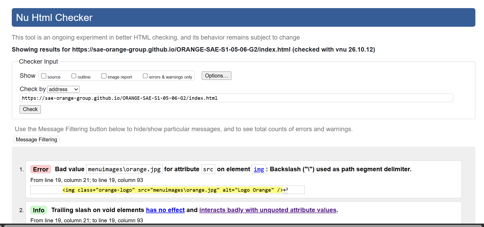
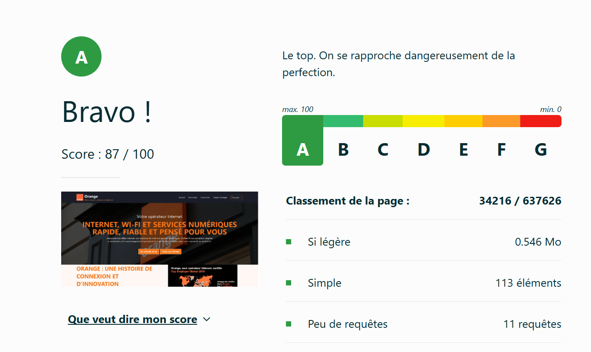
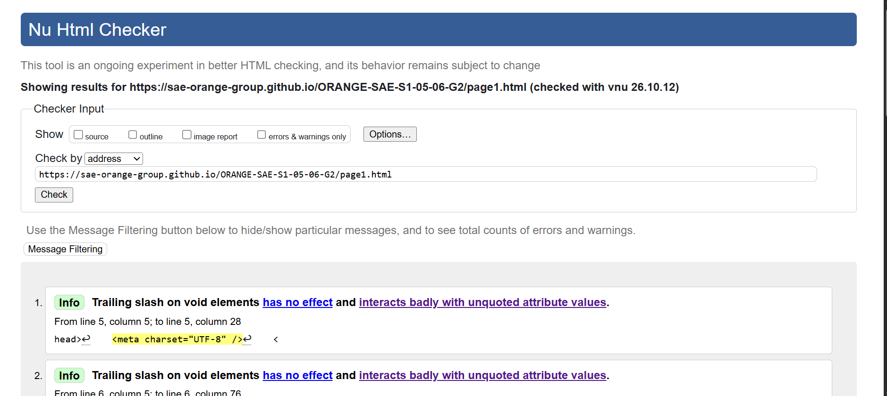
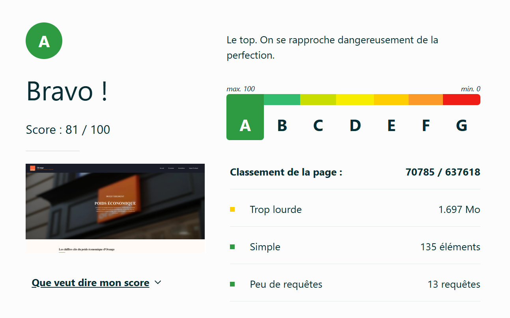
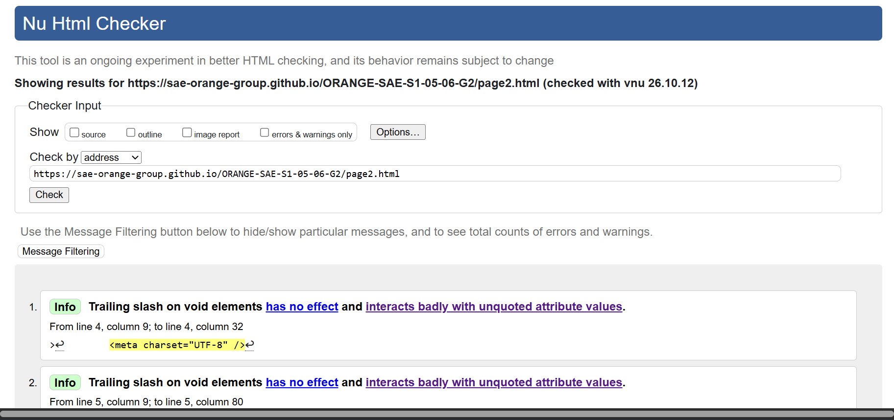
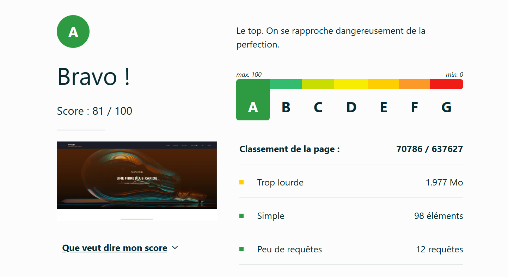
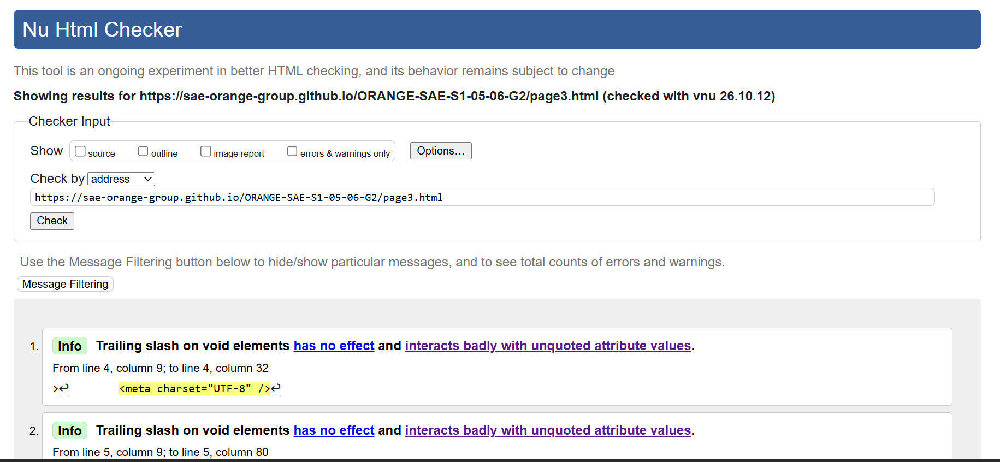
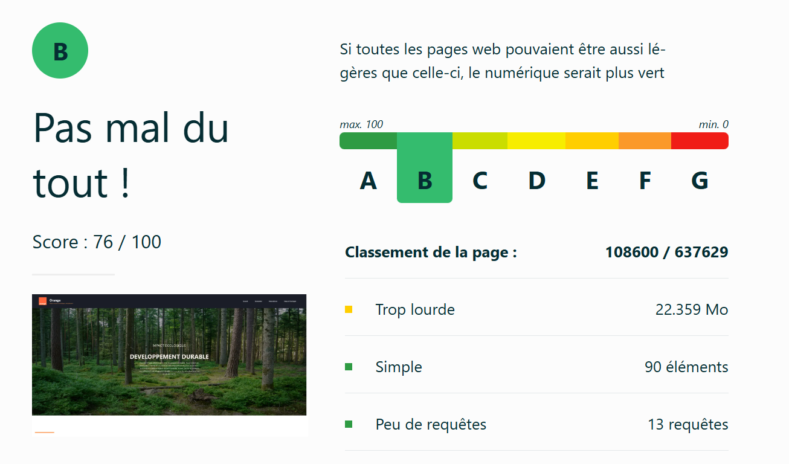

# SAÉ S1. 05-06  

## ORANGE

[ORANGE-SAE-S1-05-06-G2](https://sae-orange-group.github.io/ORANGE-SAE-S1-05-06-G2/)

## Membres du groupe :

- [Aksoy Defné (référent)](mailto:defne.aksoy@edu.univ-fcomte.fr?subject=SAE_1_05_06)  
- [Bakalec Benjamin](mailto:benjamin.bakalec@edu.univ-fcomte.fr?subject=SAE_1_05_06)   
- [Belebbayda Yassine](mailto:yassine.belebbayda@edu.univ-fcomte.fr?subject=SAE_1_05_06)
- [Benoit Fanny](mailto:fanny.benoit03@edu.univ-fcomte.fr?subject=SAE_1_05_06)   

## Présentation 

Ce dépôt correspond à un site web créé en HTML/CSS/JS dans le cadre de la SAÉ 05-06 à l'IUT de Belfort-Montbéliard. Ce site présente des informations concernant l'entreprise Orange et sert de vitrine pour présenter l'entreprise, ses activités, son organisation et son historique.

## Choix de conception  

Pour la conception du site, nous nous sommes grandement inspirés du site officiel de Orange (disponible [ici](https://www.orange.com/fr-fr/)) et nous avons pris comme référence la charte de orange disponible [ici](doc/Charte_Graphique_Orange.pdf).    

## Développement Site Web et Validation des pages

### Page d'accueil

**Auteur : Belebbayda Yassine **  

Vérification W3C : [Détail ICI](https://validator.w3.org/nu/?doc=https%3A%2F%2Fsae-orange-group.github.io%2FORANGE-SAE-S1-05-06-G2%2Findex.html)

<!--  style="width=400px" ne fonctionne pas -->

### Présentation générale

### Page 1

**Auteur : Bakalec Benjamin**  

Vérification W3C : [Détail ICI](https://validator.w3.org/nu/?doc=https%3A%2F%2Fsae-orange-group.github.io%2FORANGE-SAE-S1-05-06-G2%2Fpage1.html)

 

 

### Page 2

**Auteur : Aksoy Defné**  

Vérification W3C : [Détail ICI](https://validator.w3.org/nu/?doc=https%3A%2F%2Fsae-orange-group.github.io%2FORANGE-SAE-S1-05-06-G2%2Fpage2.html)
 

 

### Page 3

**Auteur : Benoit Fanny**  

Vérification W3C : [Détail ICI](https://validator.w3.org/nu/?doc=https%3A%2F%2Fsae-orange-group.github.io%2FORANGE-SAE-S1-05-06-G2%2Fpage3.html)

 

 

## Répartition du travail

### Planification - Diagramme de GANTT

- Benoit Fanny
- Aksoy Defné

### Recherches d'informations

- Aksoy Defné
- Bakalec Benjamin
- Belebbayda Yassine
- Benoit Fanny

### Développement site

Le projet est réalisé en groupe et chaque membre est responsable d'une thématique/ d'une page :

|Page| Membre       | Page / Thématique |           
|----| ------------ | ----------------- |
| 1  | **Yassine**  | Accueil           |
| 2  | **Benjamin** | Économie          |
| 3  | **Fanny**    | Écologie          |
| 4  | **Defne**    | Innovations       |

## Contributeurs

