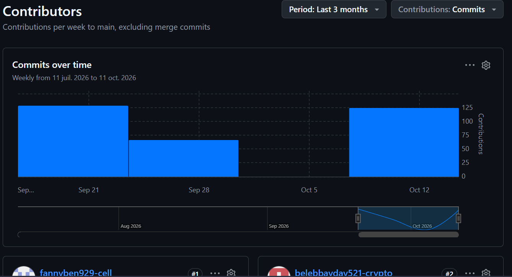

# SAÉ S1. 05-06  

## ORANGE

[ORANGE-SAE-S1-05-06-G2](https://sae-orange-group.github.io/ORANGE-SAE-S1-05-06-G2/)

## Membres du groupe :

- [Aksoy Defné (référent)](mailto:defne.aksoy@edu.univ-fcomte.fr?subject=SAE_1_05_06)  
- [Bakalec Benjamin](mailto:benjamin.bakalec@edu.univ-fcomte.fr?subject=SAE_1_05_06)   
- [Belebbayda Yassine](mailto:yassine.belebbayda@edu.univ-fcomte.fr?subject=SAE_1_05_06)
- [Benoit Fanny](mailto:fanny.benoit03@edu.univ-fcomte.fr?subject=SAE_1_05_06)   

## Présentation 

Ce dépôt correspond à un site web créé en HTML/CSS/JS dans le cadre de la SAÉ 05-06 à l'IUT de Belfort-Montbéliard. Ce site présente des informations concernant l'entreprise Orange et sert de vitrine pour présenter l'entreprise, ses activités, son organisation et son historique.

## Choix de conception  

Pour la conception du site, nous nous sommes grandement inspirés du site officiel de Orange (disponible [ici](https://www.orange.com/fr-fr/)) et nous avons pris comme référence la charte de orange disponible [ici](doc/Charte_Graphique_Orange.pdf).    

## Développement Site Web et Validation des pages

### Page d'accueil

**Auteur : Nom Prénom**  

Vérification W3C : [Détail ICI](https://validator.w3.org/nu/?doc=https%3A%2F%2Fsae-orange-group.github.io%2FORANGE-SAE-S1-05-06-G2%2Fpage1.html)

ou 

ou 

<!--  style="width=400px" ne fonctionne pas -->

### Présentation générale

**Auteur : Nom Prénom**  

Vérification W3C : [Détail ICI](https://validator.w3.org/nu/?showsource=yes&showoutline=yes&showimagereport=yes&doc=https%3A%2F%2Fdemo-am90.github.io%2Fs1-demo%2Findex.html)

 

 

## Répartition du travail

### Planification - Diagramme de GANTT

- Nom Prénom

### Recherches d'informations

- Nom Prénom
- Nom Prénom

### Développement site

- Nom Prénom
  - Page d’accueil
  - "Template" de page (Navbar/Footer)
  - Page présentation
- Nom Prénom
  - Page histoire
- Nom Prénom
  - Page organisation

## Contributeurs

